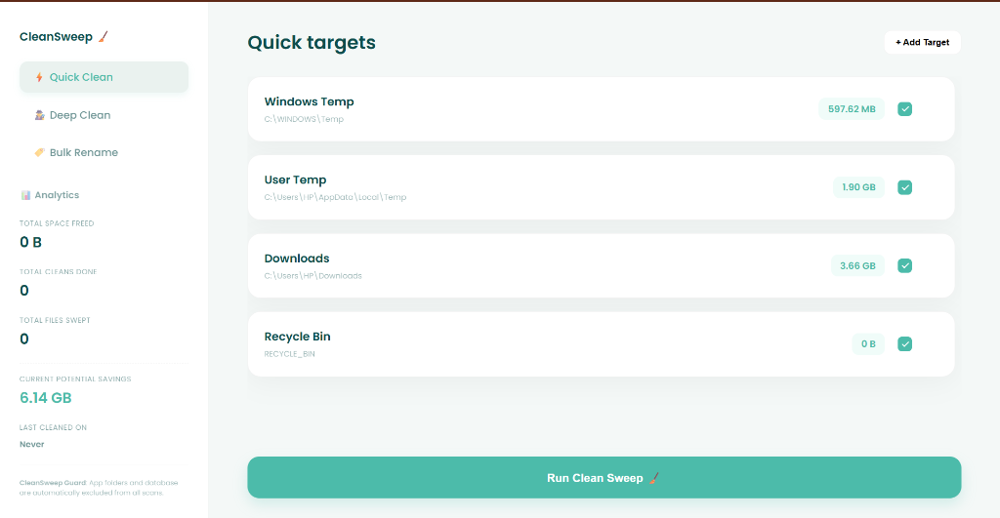

# CleanSweep 🧹

CleanSweep is a powerful, modern desktop application designed for granular system optimization. It provides developers and power users with total control over file cleanup and organization through a sleek, premium interface.

 *(Add your screenshot here)*

## ✨ Key Features

### ⚡ Quick Clean
*   **Intelligent Scanning**: Instantly analyzes standard system junk (Windows Temp, User Temp, Recycle Bin, and Downloads).
*   **Granular Extension Control**: Every folder is scanned for unique file extensions. You can uncheck specific file types (e.g., keep `.log` files but delete `.tmp`) on a per-folder basis.
*   **Dynamic Sizing**: Real-time feedback on how much space you'll save as you toggle folders and extensions.

### 🕵️ Deep Clean (Drive Wiping)
*   **Full Drive Crawl**: Select any storage drive (C:\, D:\, etc.) and perform a comprehensive sweep of all file types.
*   **Extension-Based Filtering**: Search the entire drive for specific extensions and wipe them in bulk.
*   **App Guard Protection**: Built-in safety engine automatically detects the CleanSweep installation and protects it from accidental self-deletion.

### 🏷️ Bulk Rename
*   **Sequential Numbering**: Batch rename files in any folder using a pattern (e.g., `Project - 1.jpg`, `Project - 2.jpg`).
*   **No-Spaces Mode (Dev Mode)**: A toggle for developers to rename files without spaces (e.g., `Project1.jpg`), ideal for web assets and code dependencies.
*   **Live Preview**: Instantly see a preview of your naming pattern before executing.

### 📊 Advanced Analytics
*   **Persistent Tracking**: Integrated SQLite database tracks your total history of space freed and files cleaned.
*   **Sidebar Dashboards**: Live counters for total lifetime savings and current "Potential Savings" based on your active selections.

---

## 🚀 Getting Started

### For Users
1. Download `CleanSweep.exe` from the [Releases](https://github.com/kiranmayee-abbireddy/cleansweep/releases) page.
2. Run the executable.
3. Use **Quick Clean** for daily maintenance or **Deep Clean** for massive storage reclamation.

### For Developers (Cloning & Local Setup)

If you want to run the code locally or contribute:

**1. Clone the Repository**
```bash
git clone https://github.com/kiranmayee-abbireddy/cleansweep.git
cd cleansweep
```

**2. Setup Virtual Environment**
```bash
python -m venv venv
source venv/Scripts/activate  # On Windows: .\venv\Scripts\activate
```

**3. Install Dependencies**
```bash
pip install -r requirements.txt
```

**4. Run the App**
```bash
python main.py
```

---

## 🛠️ Build Information

To package the application into a single standalone executable (Single UI version without console):

```bash
pip install pyinstaller
pyinstaller --noconfirm --onefile --windowed \
            --add-data "static;static" \
            --add-data "templates;templates" \
            --name CleanSweep main.py
```

### Technical Stack
*   **Backend**: Flask (Python)
*   **Frontend**: Vanilla HTML5, CSS3 (Modern Flexbox/Grid), JavaScript (ES6+)
*   **Native Bridge**: PyWebView
*   **Database**: SQLite3
*   **Design**: Mint Cascade Theme (Custom Design System)

---

## 🛡️ License
Distributed under the MIT License. See `LICENSE` for more information.
